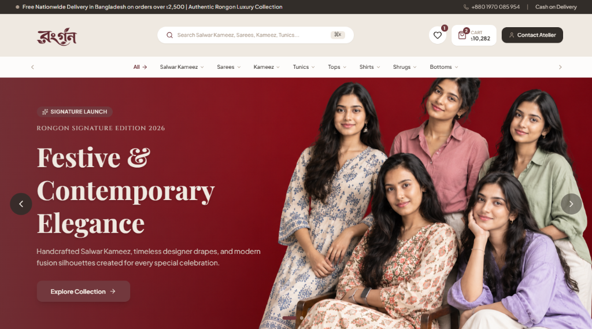
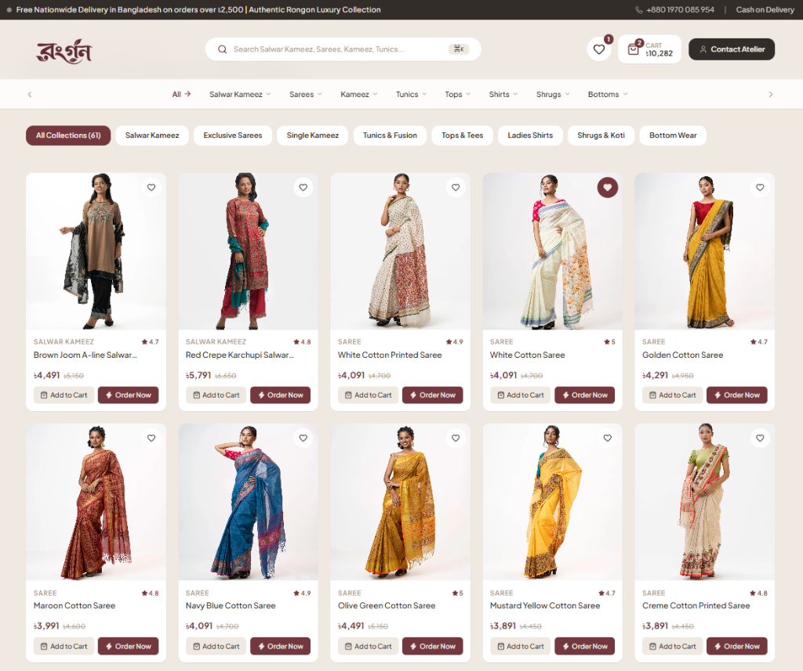
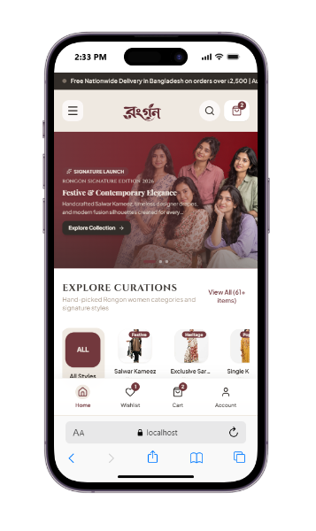

# রংগন (Rongon) — Luxury Women's Fashion & Heritage Drapes Atelier

<div align="center">

[](https://react.dev/)
[](https://vitejs.dev/)
[](https://tailwindcss.com/)
[]()

**An ultra-premium, high-fashion e-commerce storefront for Rongon (রংগন)**  
*Exclusive Salwar Kameez, Heritage Sarees, Single Kameez, Tunics & Contemporary Ethnic Drapes*

</div>

---

## 🌟 Visual Showcase

### 1. Hero Showcase & Dynamic Navigation
The signature hero experience featuring authentic artisanal imagery, smooth auto-advance transitions, custom brand banner integration, keyboard-accessible instant search (`Ctrl/⌘ + K`), and interactive category navigation.

<div align="center">
  
</div>

<br />

### 2. Full Boutique Catalogue & Minimalist Product Cards
Artisanal collection grid engineered with clean aesthetics, real-time category filtering (61 curated styles), BDT (৳) pricing, rating indicators, and dual quick-action buttons (*Add to Cart* & *Order Now*).

<div align="center">
  
</div>

<br />

### 3. Mobile First & Adaptive Device Experience
Tailored specifically for hand-held devices with gesture swipe support, clean 2-layer typography, and dedicated mobile bottom navigation bar.

<div align="center">
  
</div>

---

## 📖 Table of Contents
- [Design & Aesthetics](#-design--aesthetics)
- [Key Features](#-key-features)
- [Tech Stack](#-tech-stack)
- [Project Architecture](#-project-architecture)
- [Getting Started](#-getting-started)
- [Database & Backend Integration Guide](#-database--backend-integration-guide)
- [Scripts & Commands](#-scripts--commands)
- [License](#-license)

---

## 🎨 Design & Aesthetics

The storefront embodies timeless South Asian luxury, warmth, and modern minimalism.

| Color Token | Hex | Role |
| :--- | :--- | :--- |
| **Deep Crimson / Maroon** | `#72383D` | Primary luxury accent, CTA buttons, active badges, highlights |
| **Warm Espresso / Dark Charcoal** | `#322D29` | Deep contrast backgrounds, brand typography, secondary buttons |
| **Silk Cream / Off-White** | `#EFE9E1` | Soft page background, elegant card contrast, light surface fills |
| **Muted Taupe / Sand** | `#AC9C8D` | Subtitles, borders, subtle text, rating and metadata tags |
| **Warm Canvas Light** | `#F8F6F2` | Product card surfaces, input fields, header background |

- **Typography**:
  - `Playfair Display` & `Cinzel` for editorial luxury serif headings.
  - `Plus Jakarta Sans` / `Outfit` for crisp, ultra-legible numerals and interface text.
  - Authentic Bengali typography for the brand mark: **রংগন**.

---

## 🚀 Key Features

### 🛍️ Comprehensive E-Commerce Experience
- **Interactive Hero Carousel**:
  - Auto-advance rotation with touch swipe support (`onTouchStart` / `onTouchEnd`).
  - Desktop: Rich subtitles, descriptions, and category CTA buttons.
  - Mobile: Clean 2-layer headline (*"Festive & Contemporary Elegance"*) with instant *"Shop Now"* action.
- **Dynamic Category Navigation**:
  - Multi-tier dropdown menus for Salwar Kameez, Sarees, Kameez, Tunics, Tops, Shirts, Shrugs, and Bottom Wear.
  - Smooth horizontal scroll buttons with overflow indicators.
- **61 Curated Authentic Mock Products**:
  - Complete with high-resolution photography, alternate hover previews, realistic price ranges, discounts, and SKU references.
- **Minimalist Product Cards**:
  - Stripped of cluttered stickers for a high-end designer look.
  - Hover zoom transitions, wishlist heart toggle, stock indicators, and dual CTA (*Add to Cart* and *Order Now*).
- **Interactive Cart & Wishlist System**:
  - Sliding Cart Drawer with live item increment/decrement and removal.
  - Free nationwide delivery progress threshold (৳2,500 target).
  - Real-time subtotal calculation in Bangladeshi Taka (৳).
- **Curated Spotlight Section**:
  - Signature feature banner paired with top festive picks.
- **Instant Search Modal**:
  - Global hotkey shortcut (`⌘K` / `Ctrl+K`) with live query suggestions and keyboard navigation.
- **Social Proof & Reviews**:
  - Verified buyer feedback from Dhaka, Chittagong, and Sylhet.
  - Instagram community showcase grid.
- **Persistent Mobile Bottom Bar**:
  - Fast access to Home, Wishlist (with badge counter), Cart Drawer, and Customer Account.

---

## 💻 Tech Stack

- **Core**: [React 19](https://react.dev/)
- **Bundler & Dev Server**: [Vite 8](https://vitejs.dev/)
- **Styling**: [Tailwind CSS v4](https://tailwindcss.com/)
- **Routing**: [React Router v7](https://reactrouter.com/)
- **Icons**: [Lucide React](https://lucide.dev/) & [FontAwesome](https://fontawesome.com/)
- **State Management**: React Context API (`ShopContext`) with `localStorage` persistence.

---

## 📂 Project Architecture

```plaintext
leeswhim/
├── screenshots/                  # High-resolution README showcase previews
│   ├── hero-preview.png          # Desktop Hero & Navigation preview
│   ├── catalog-preview.png       # Catalogue & Product Cards preview
│   └── mobile-preview.png        # Mobile responsive preview
├── src/
│   ├── assets/                   # Brand logos, banners, and static media
│   │   ├── banner.png            # Custom Rongon hero campaign banner
│   │   ├── logo.png              # Primary brand insignia
│   │   └── logoWhite.png         # Inverted light insignia
│   ├── Components/
│   │   ├── common/
│   │   │   ├── CartDrawer.jsx    # Sliding cart drawer with subtotal
│   │   │   ├── ProductCard.jsx   # Minimalist luxury product card
│   │   │   └── QuickOrderModal.jsx # Instant single-click checkout modal
│   │   ├── home/
│   │   │   ├── HeroSlider.jsx    # Responsive campaign hero carousel
│   │   │   ├── CategoryBar.jsx   # Curations horizontal carousel
│   │   │   ├── CuratedSpotlight.jsx # Featured collection spotlight
│   │   │   ├── PromoBanners.jsx  # Dual promotion cards (desktop/tablet)
│   │   │   ├── CatalogSection.jsx# 61-item filterable boutique catalogue
│   │   │   ├── CustomerReviews.jsx # Verified customer testimonials
│   │   │   ├── InstagramShowcase.jsx # Social styling inspiration grid
│   │   │   └── TrustBadges.jsx   # Nationwide delivery & guarantee perks
│   │   └── layout/
│   │       ├── Navbar.jsx        # Announcement, search modal, categories
│   │       ├── Footer.jsx        # Editorial atelier footer & newsletter
│   │       └── MobileBottomNav.jsx # Bottom dock navigation for phones
│   ├── Context/
│   │   └── ShopContext.jsx       # Cart, wishlist, filters, and modal states
│   ├── data/
│   │   └── mockProducts.js       # 61 authentic curated items & categories
│   ├── pages/
│   │   ├── Home.jsx              # Main atelier landing page
│   │   ├── Cart.jsx              # Full page cart review
│   │   ├── Checkout.jsx          # Secure checkout order form
│   │   └── ProductDetail.jsx     # Detailed product view with zoom
│   ├── App.jsx                   # Route configurations and layout wrapper
│   ├── index.css                 # Custom font imports & Tailwind rules
│   └── main.jsx                  # Application entry point
├── package.json                  # Dependencies & scripts
└── vite.config.js                # Vite build configuration
```

---

## ⚡ Getting Started

### Prerequisites
- [Node.js](https://nodejs.org/) (Version 18.x, 20.x, or later recommended)
- `npm` or `yarn` / `pnpm`

### Installation

1. **Clone or open the repository**:
   ```bash
   cd "Lee's Whim/Lee's Whim Frontend/leeswhim"
   ```

2. **Install project dependencies**:
   ```bash
   npm install
   ```

3. **Start the local development server**:
   ```bash
   npm run dev
   ```
   Open your browser at `http://localhost:5173/` to view the live storefront.

---

## 🗄️ Database & Backend Integration Guide

All products and categories are cleanly structured in [`src/data/mockProducts.js`](./src/data/mockProducts.js) and consumed through [`src/Context/ShopContext.jsx`](./src/Context/ShopContext.jsx).

### Connecting to your REST or GraphQL API:
Replace the static imports in [`ShopContext.jsx`](./src/Context/ShopContext.jsx) with your API fetch / React Query hook:

```javascript
// Example: src/Context/ShopContext.jsx
useEffect(() => {
  async function fetchProducts() {
    try {
      const response = await fetch("https://api.yourdomain.com/v1/products");
      const data = await response.json();
      setProducts(data);
    } catch (err) {
      console.error("Failed to load products from database:", err);
    }
  }
  fetchProducts();
}, []);
```

### Product Schema Reference:
```typescript
interface Product {
  id: string;
  productId: number;
  sku: string;
  name: string;
  category: string;
  subCategory: string;
  categorySlug: string;
  price: number;
  originalPrice: number;
  discount: string;
  rating: number;
  reviewCount: number;
  inStock: boolean;
  stockCount: number;
  image: string;
  hoverImage: string;
  galleryImages: string[];
  fabric: string;
  workType: string;
  careInstructions: string;
}
```

---

## 🛠️ Scripts & Commands

| Command | Description |
| :--- | :--- |
| `npm run dev` | Launches Vite local development server with Hot Module Replacement |
| `npm run build` | Compiles optimized production bundle into `/dist` |
| `npm run preview` | Previews the production build locally |
| `npm run lint` | Runs ESLint analysis across codebase |

---

## 📄 License

© 2026 **রংগন (Rongon)**. All rights reserved. Proprietary and confidential.
